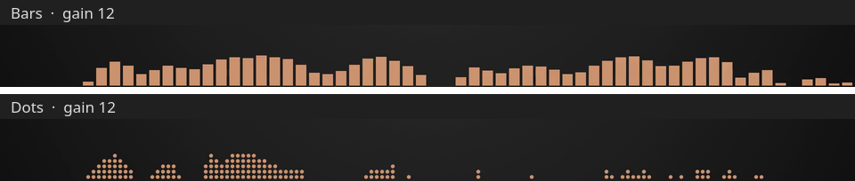

# Audio Visualizer for ComfyUI

Turn a still image and audio into an MP4 with a bar or dots spectrum.



## Install

- **ComfyUI-Manager:** search for _Audio Visualizer_ (Registry ID
  `comfyui-audiovisualizer`) and install it.
- **comfy-cli:** `comfy node install comfyui-audiovisualizer`.
- **Manually:** `git clone https://github.com/bno84/ComfyUI-AudioVisualizer` into
  `ComfyUI/custom_nodes/`.

Then restart ComfyUI and refresh the browser. Requires ComfyUI 0.38.0 or
newer; no extra Python packages or GPU.

FFmpeg must be on `PATH`, with `showcqt` and the selected encoders:
`libx264` / `libx265` for video; `flac`, `aac`, or `libopus` for audio.

## Use

Add **🎵 Audio visualizer video (still + spectrum)** from **audio/visualize**
and connect an image and audio. It saves to ComfyUI's output folder and
returns a `VIDEO`, with the workflow embedded in the file.

- **Visualization:** bars or dots, color, gain, glow, and trails. Dot spacing
  appears in dots mode. Gain 0 uses the style default: bars 2, dots 32.
- **Timing:** 30/60 FPS, start, and duration in seconds. Duration 0 uses the
  rest of the audio.
- **Codecs:** H.265 (CRF 18) or H.264 (CRF 22); FLAC (default), AAC
  (192 kbps), or Opus (128 kbps). Each codec keeps its own settings.

The filename includes the style automatically, e.g.
`video/song_visualizer_bars_00001_.mp4`. Disable `enabled` to skip rendering.

## Tests

```sh
python3 -m unittest discover -s tests
node --test tests/*.mjs
```

Render tests need FFmpeg and FFprobe.
