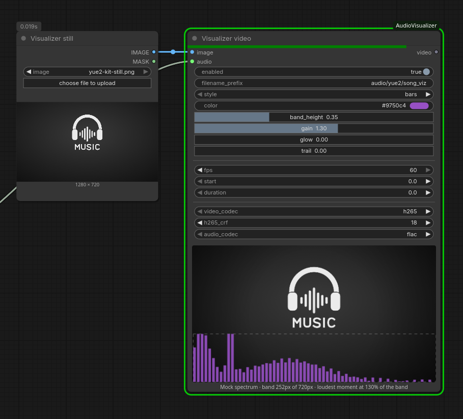

# Audio Visualizer for ComfyUI

Turn a still image and audio into an MP4 with a bar or dots spectrum.
Insert your own image and use the mock preview to adjust the style.



## Install

- **ComfyUI-Manager:** search for _Audio Visualizer_ (Registry ID
  `comfyui-audiovisualizer`) and install it.
- **comfy-cli:** `comfy node install comfyui-audiovisualizer`.
- **Manually:** `git clone https://github.com/bno84/ComfyUI-AudioVisualizer` into
  `ComfyUI/custom_nodes/`.

Then restart ComfyUI and refresh the browser. Requires ComfyUI 0.38.0 or
newer; no extra Python packages or GPU.

FFmpeg must be on `PATH`, with `showcqt` and the selected encoders:
`libx264` / `libx265` for video; `flac`, `aac`, or `libopus` for audio.

## Use

Add **🎵 Audio visualizer video (still + spectrum)** from **audio/visualize**
and connect an image and audio. It saves to ComfyUI's output folder and
returns a `VIDEO`, with the workflow embedded in the file.

- **Visualization:** bars or dots, color, band height, gain, glow, and trails.
  Dot spacing appears in dots mode.
- **Band height:** the spectrum band's share of the video height, 0.1–0.9
  (default 0.35).
- **Gain:** the height of the loudest moment. The audio is measured before
  rendering, so 1.0 makes the loudest bar or dot column just reach the top of
  the band, whatever the volume. The default 1.3 lets the loudest peaks clip;
  the range is 0.25–2.
- **Vignette:** edge darkening from 0 (off) to 1 (strongest). The default
  is 0 (off); 0.4 reproduces the original look. Workflows without this control
  also default to off; explicitly saved strengths are preserved.
  The preview approximates the selected strength.
- **Preview:** the node shows the connected still with the band at its height
  and a mock spectrum peaking at the chosen gain, to check placement before
  rendering. The spectrum shape is made up; only the real render uses the
  audio.
- **Timing:** 30/60 FPS, start, and duration in seconds. Duration 0 uses the
  rest of the audio.
- **Codecs:** H.265 (CRF 18) or H.264 (CRF 22); FLAC (default), AAC
  (192 kbps), or Opus (128 kbps). Each codec keeps its own settings.

The filename includes the style automatically, e.g.
`video/song_visualizer_bars_00001_.mp4`. Disable `enabled` to skip rendering.

Measuring takes one extra FFmpeg pass over the rendered span, a few percent of
its length.

Workflows saved with 0.1 keep their settings, but gain resets to 1.3: it used
to be a raw volume. API prompts from 0.1 need `band_height` and a gain between
0.25 and 2.0.

## Tests

```sh
python3 -m unittest discover -s tests
node --test tests/*.mjs
```

Render tests need FFmpeg and FFprobe.
